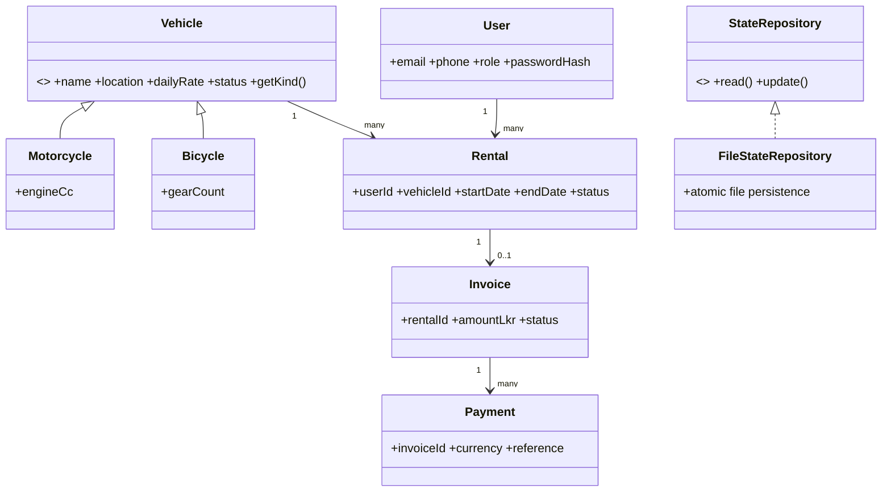
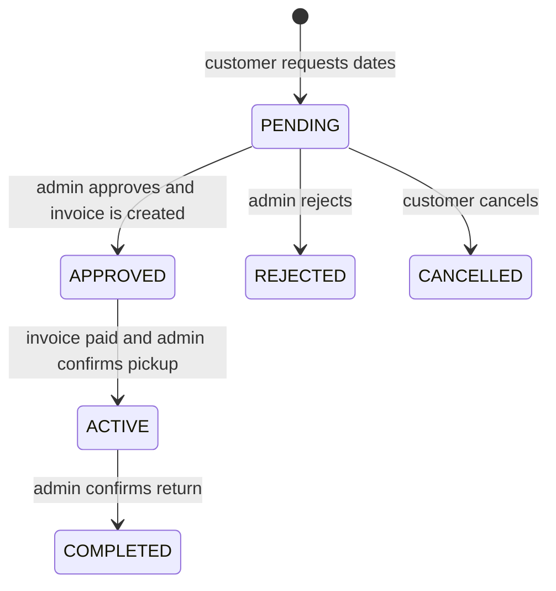

# NexRide architecture and project workflow

## How we approached it

The project starts at the vehicle collection: visitors can discover motorcycles or bicycles, request rental dates, wait for admin confirmation, then pay and complete pickup/return. In a separate flow, users can publish a community ride and request seats. Customers can review a vehicle after a completed rental or contact support. Admins maintain the fleet, bookings, website identity and contact details.

The workflow borrows useful interaction patterns from real rental platforms: clear date/vehicle search, an explicit request and owner confirmation step, and a pickup/return inspection sequence. Riders Share describes search, date selection, pickup inspection and return inspection; ListNRide describes finding a bike, requesting it, waiting for owner confirmation and arranging handover. NexRide labels its own business rules and does not claim affiliation with these services.

- [Riders Share — How it works](https://www.riders-share.com/how-it-works)
- [ListNRide — How it works](https://www.listnride.com/how-it-works)

## OOP map

- **Abstraction and inheritance:** `Vehicle` is abstract; `Motorcycle` and `Bicycle` provide specialized fields. Jackson polymorphism persists and restores both types.
- **Encapsulation:** each entity keeps private fields and exposes accessors. Services enforce valid state transitions and role checks.
- **Polymorphism:** fleet operations work with `Vehicle` while rendering and serialization retain subtype-specific data.
- **Separation of concerns:** controllers handle HTTP; services implement business rules; `StateRepository` defines persistence; `FileStateRepository` supplies atomic text-file persistence.

## Rental lifecycle

Overlapping pending, approved or active dates block a second request for the same vehicle. Seven-day rentals receive a 10% discount. Current version limits customer cancellation to pending requests and does not process refunds.

## Team split

| Owner | Work area | Typical classes / APIs |
|---|---|---|
| Kalhara | User management | `User`, `UserService`, `/api/register`, `/api/login`, `/api/profile` |
| Nipuna | Bike management | `Vehicle`, `Motorcycle`, `Bicycle`, `FleetService`, `/api/bikes`, `/api/media` |
| Siyas | Rental request management | `RentalService`, `Invoice`, `/api/rentals` |
| Thinal | Ride sharing | `RideOffer`, `RideBooking`, `RideService`, `/api/rides` |
| Murshid | Payment and billing | `BillingService`, `OnlinePaymentService`, `/api/invoices`, `/api/payments` |
| Galkotuwa | Reviews and issue reports | `FeedbackService`, `Review`, `Issue`, `/api/reviews`, `/api/issues` |

## File storage

The app persists `AppState` as readable JSON text in `data/nexride-data.txt`. Every write works on a copy, serializes to a temporary sibling file, flushes it and atomically renames it. A file lock rejects a second process pointed at the same data folder. Image files live separately in `data/uploads/`.

## API overview

| Area | API paths |
|---|---|
| Session and account | `/api/session`, `/api/register`, `/api/login`, `/api/admin/login`, `/api/profile` |
| Fleet | `/api/public`, `/api/bikes`, `/api/media` |
| Rentals | `/api/rentals`, `/api/rentals/{id}/action` |
| Ride sharing | `/api/rides`, `/api/ride-bookings` |
| Billing | `/api/invoices`, `/api/payments`, `/api/invoices/{id}/checkout` |
| Feedback | `/api/reviews`, `/api/issues` |
| Admin | `/api/admin/summary`, `/api/admin/users`, `/api/settings` |

See the source service/controller classes for request fields and validation.
